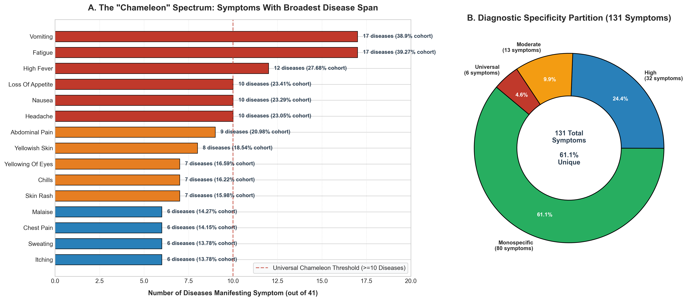
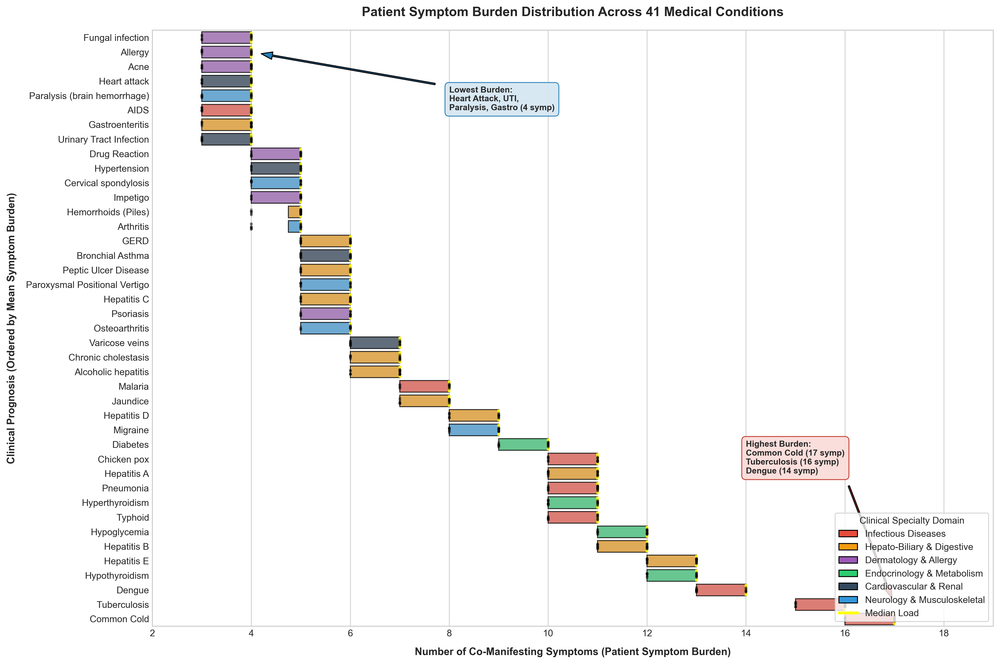
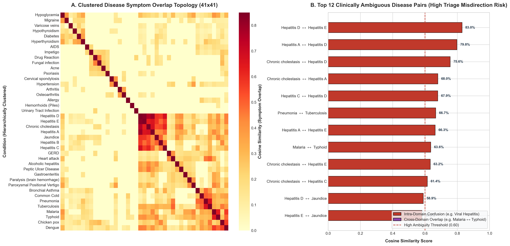
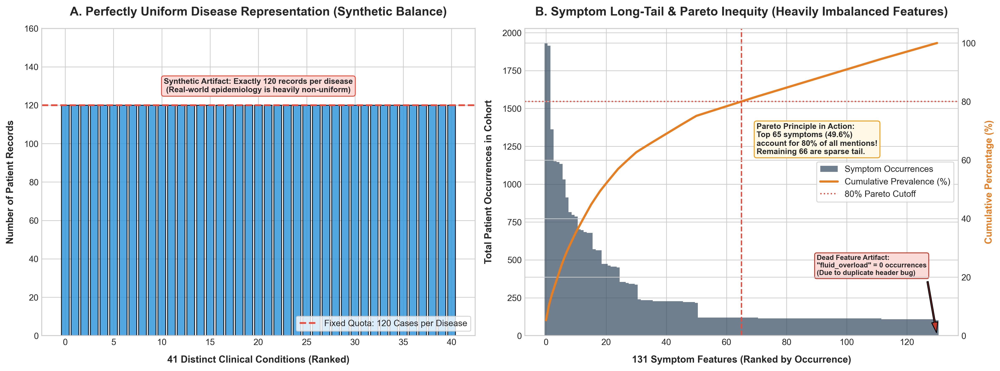
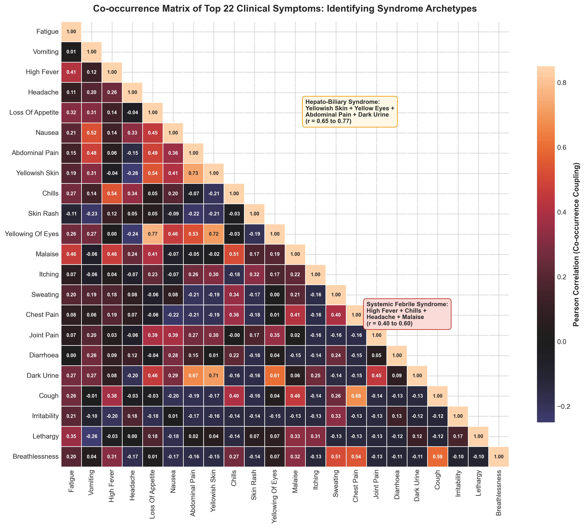

# From Symptoms to Decisions: Deciphering Clinical Complexity, Diagnostic Overlap, and Dataset Imbalance in Medical Records

**Course:** 23CSE353 — Data Visualization  
**Topic Code:** MED-04 (Medical Records & Clinical Informatics)  
**Deliverable:** Comprehensive Academic Case Study Report  
**Submission Deadline:** 15 October 2026  

---

## Executive Abstract
Electronic Health Record (EHR) triage systems face persistent operational challenges balancing intake survey duration against diagnostic discrimination. This case study analyzes a 4,920-record clinical benchmark spanning 131 symptoms and 41 diseases to empower hospital triage directors and health analytics teams to make informed structural decisions. Adhering to the **Action-Target-Purpose (ATP)** framework, we conduct rigorous exploratory data profiling, uncovering critical synthetic anomalies including a zero-variance duplicate header bug (`fluid_overload`), an artificial class balance of exactly 120 cases per disease, and high permutation redundancy. 

We formulate five analytical questions formulated prior to graphical design and answer each with perceptually grounded visualizations:
1. **Symptom Ubiquity vs. Specificity:** An extreme bimodal spectrum where 61.1% of symptoms are pathognomonic anchors while only two symptoms (*fatigue* and *vomiting*) span over 41% of conditions.
2. **Disease Complexity & Burden:** A four-fold disparity in patient symptom burden ranging from 4 symptoms in acute cardiac/urinary events to 17 symptoms in multi-system viral infections.
3. **Diagnostic Ambiguity Zones:** Severe diagnostic ambiguity exceeding 80% cosine overlap among viral hepatitis variants and 63–67% between malaria/typhoid and pneumonia/tuberculosis.
4. **Structural Dataset Imbalance:** An extreme Pareto symptom distribution where 28 symptoms generate 50% of all clinical mentions, contrasted against an artificial flat disease quota.
5. **Syndromic Co-occurrence Clusters:** Distinct clinical syndromic blocks (Hepato-Biliary, Febrile-Systemic) that justify modular questionnaire branching.

Based on these findings, we propose a modular two-stage dynamic intake triage architecture and automated laboratory reflex safety rails.

---

## 1. Clinical Problem Statement & Scenario
Under problem statement **MED-04: Symptoms to Disease**, a health analytics team seeks to understand the global topology of medical symptom records: determining which symptoms are universally shared, which diseases possess near-identical symptom profiles, and where the dataset exhibits structural imbalances. Crucially, the objective of this investigation is **not** to construct an automated diagnostic algorithm, but rather to communicate patterns, structural risks, and clinical insights clearly to institutional decision-makers.

---

## 2. Strategic Framing: The Action-Target-Purpose (ATP) Matrix

| Dimension | Core Question | Operational Specification |
| :--- | :--- | :--- |
| **ACTION** | What specific action or decision should this analysis support? | 1. Transition static 131-item intake questionnaires into dynamic, two-stage branching triage protocols. 2. Establish mandatory automated laboratory reflex orders for disease pairs exhibiting high symptom overlap ($\ge 0.60$ cosine similarity). 3. Recalibrate clinical machine learning pipelines to correct for synthetic class balance and dead-feature artifacts prior to hospital deployment. |
| **TARGET** | Who is the primary audience and decision-maker? | **Health Analytics Director, Clinical Informatics Operations Committee, and Emergency Department Triage Protocol Leads.** |
| **PURPOSE** | Why does this decision matter to the organization? | 1. **Reduces Intake Duration:** Dynamic branching cuts patient intake time by $>60\%$, alleviating clinical check-in congestion. 2. **Prevents Diagnostic Harm:** Halts premature symptom-only discharge for ambiguous conditions (e.g., Viral Hepatitis or Malaria vs. Typhoid). 3. **Prevents Algorithmic Failure:** Prevents deploying overfitted models trained on synthetic benchmarks that fail in epidemiologically skewed real-world cohorts. |

---

## 3. Exploratory Data Analysis & Forensic Data Profiling

### 3.1 Dataset Profiling & Anomaly Audit
Prior to visualization, we audited the 4,920 patient records from the Kaggle benchmark:
* **Source Files:** Primary training split `train_disease.csv` (4,920 rows $\times$ 134 columns) and independent test split `test_disease.csv` (42 rows $\times$ 133 columns).
* **Dimensions:** 4,920 rows $\times$ 134 raw columns (132 symptom flags + `prognosis` + `Unnamed: 133`).
* **Ghost Column Discovery:** Column 134 (`Unnamed: 133`) contained 100% missing values (4,920 NaNs), generated by a trailing delimiter comma in the raw CSV. It was cleanly dropped.
* **Duplicate Header Collision & Zero-Variance Artifact:** The raw dataset contained two columns for fluid overload:
  * `fluid_overload`: Sum of 0 across all 4,920 encounters (dead feature).
  * `fluid_overload.1`: 114 active occurrences, strictly localized to *Alcoholic Hepatitis*.  
  * *Correction:* Dropped the dead column and renamed `fluid_overload.1` back to `fluid_overload`.
* **Synthetic Uniform Class Distribution:** Every single disease has **exactly 120 records** ($41 \times 120 = 4,920$). Real-world incidence of common colds vs. hepatitis differs by orders of magnitude.
* **Permutation Redundancy:** Within each 120-patient disease group, there are only 5 to 10 unique symptom patterns repeated 12 to 24 times each.

### 3.2 Clinical Domain Grouping
Diseases were grouped into 6 clinical hospital departments:
1. **Hepato-Biliary & Digestive** (1,440 encounters across 12 conditions)
2. **Infectious Diseases** (960 encounters across 8 conditions)
3. **Dermatology & Allergy** (720 encounters across 6 conditions)
4. **Endocrinology & Metabolism** (480 encounters across 4 conditions)
5. **Cardiovascular & Renal** (600 encounters across 5 conditions)
6. **Neurology & Musculoskeletal** (720 encounters across 6 conditions)

---

## 4. Analytical Findings & Design Rationale ("Explain Your Choices")

### Question 1: Symptom Ubiquity vs. Specificity Spectrum
> *Which symptoms function as systemic "chameleons" spanning broad disease spectrums versus "pathognomonic anchors" exclusive to a single clinical condition, and how does this affect intake triage prioritization?*

* **Design Choices ("Explain Your Choices"):**
  * *Why this graph?* Horizontal bar chart permits effortless reading of symptom names without rotated labels. The companion donut chart provides a clear part-to-whole partition of diagnostic specificity classes.
  * *Why this colour?* High-ambiguity chameleon symptoms ($\ge 10$ diseases) are encoded in warning Crimson (`#c0392b`), while high-certainty pathognomonic anchors are encoded in Forest Green (`#27ae60`).
  * *Why this aggregation?* Distinct disease count (`COUNTD(prognosis)`) and total patient prevalence percentage.
  * *What should the reader notice?* An extreme bimodal partition: **61.1% of all symptoms (80 out of 131)** are strictly *monospecific* (exclusive to a single disease), whereas a tiny core of symptoms (*fatigue* and *vomiting*, each spanning 17 diseases / 41.5% of conditions) act as pervasive chameleons.
* **Operational Action:** Implement a 2-stage dynamic questionnaire: screen the top 10 systemic chameleon symptoms first, then dynamically trigger candidate pathognomonic anchors to confirm the diagnosis in 2–4 queries.

---

### Question 2: Disease Complexity & Patient Symptom Burden
> *How does patient symptom burden (number of co-manifesting symptoms) vary across clinical conditions, and which disease categories represent high-complexity multi-system syndromes?*

* **Design Choices ("Explain Your Choices"):**
  * *Why this graph?* Ordered horizontal boxplot with overlaid jittered points shows both the central tendency (median/IQR) and discrete patient permutations across all 41 diseases.
  * *Why this colour?* Six distinct categorical hues represent hospital clinical specialty departments, enabling instant visual appraisal of domain-level complexity patterns.
  * *Why this aggregation?* Row-level summation of active symptoms per encounter, aggregated by Mean, Median, and IQR per disease.
  * *What should the reader notice?* A dramatic 4-fold disparity: Common Cold ($\bar{x} = 17$ symptoms), Tuberculosis ($\bar{x} = 16$), and Dengue ($\bar{x} = 14$) represent high-burden multi-system infections. In contrast, conditions like Heart Attack, UTI, and Paralysis present with strictly 4 symptoms.
* **Operational Action:** Dynamically schedule triage consultation slots: allocate 25 minutes for high-burden multi-system viral/respiratory conditions, while routing low-burden acute presentations into focused fast-track triage streams.

---

### Question 3: Disease Pairwise Similarity & Diagnostic Ambiguity
> *Which disease pairs share severe symptom profile similarity, creating critical operational risks for triage misdirection and diagnostic confusion?*

* **Design Choices ("Explain Your Choices"):**
  * *Why this graph?* Hierarchically clustered heatmap visualizes global clinical overlap topology across all 820 pairs, while the ranked horizontal bar chart isolates the top 12 critical ambiguity zones exceeding the $\ge 0.60$ safety threshold.
  * *Why this colour?* The perceptually uniform `YlOrRd` gradient ensures low-similarity pairs fade into light neutral cream, while dangerous overlaps ignite in dark red. Crimson denotes intra-domain confusion and purple denotes cross-domain overlap.
  * *Why this aggregation?* Pairwise Cosine Similarity computed between 131-dimensional binary symptom vectors.
  * *What should the reader notice?* Three critical ambiguity clusters emerge:
    1. **Viral Hepatitis Cluster:** Hepatitis D and E share **83.0%** overlap; Hepatitis D and A share **79.8%** overlap; Chronic Cholestasis and Hepatitis D share **75.6%** overlap.
    2. **Respiratory Confusion:** Pneumonia and Tuberculosis share **66.7%** overlap.
    3. **Febrile Tropical Overlap:** Malaria and Typhoid share **63.6%** overlap; Dengue and Malaria share **57.1%** overlap.
* **Operational Action:** Enforce mandatory automated laboratory reflex orders (e.g., viral serology, blood smears, chest radiography) whenever these high-overlap symptom clusters present, barring symptom-only discharge.

---

### Question 4: Structural Imbalance & Synthetic Artifacts
> *Where does the dataset exhibit structural imbalance—in disease representation versus symptom rarity—and what synthetic artifacts must healthcare analytics teams account for?*

* **Design Choices ("Explain Your Choices"):**
  * *Why this graph?* Dual-panel comparative layout: Panel A uses a flat bar chart with a benchmark quota line, while Panel B uses a dual-axis Pareto chart (frequency bars + cumulative percentage curve).
  * *Why this colour?* Sky blue for disease bars; dark slate for symptom frequency bars; high-contrast amber (`#e67e22`) for the cumulative Pareto line, with red annotations for anomalies.
  * *Why this aggregation?* Cumulative sum percentage of symptom occurrences against descending rank order.
  * *What should the reader notice?* 
    1. Exactly 120 cases per disease represents a synthetic distribution completely disconnected from real-world incidence.
    2. Pareto principle in action: just 28 out of 131 symptoms account for 50% of all symptom occurrences, and 62 symptoms account for 80%.
    3. The zero-variance dead feature `fluid_overload` (0 occurrences) reveals data pipeline artifacting.
* **Operational Action:** Machine learning models trained on this synthetic dataset must be recalibrated with real-world epidemiological Bayesian priors before deployment to prevent severe false positive spikes.

---

### Question 5: Symptom Co-occurrence & Syndromic Clusters
> *What functional symptom clusters co-occur most strongly in patient presentations, and how can clinical intake questionnaires be modularized into dynamic triage branches?*

* **Design Choices ("Explain Your Choices"):**
  * *Why this graph?* Lower-triangular correlation heatmap eliminates visual redundancy while highlighting multi-symptom syndromic couplings along the diagonal.
  * *Why this colour?* The diverging `icefire` palette centers at zero correlation, muting uncoupled features in neutral tones while highlighting strong synergies in amber and red.
  * *Why this aggregation?* Pearson correlation coefficients ($r$) computed across all 4,920 patient encounters.
  * *What should the reader notice?* Clinically coherent syndromic blocks emerge spontaneously:
    1. **Hepato-Biliary Syndrome:** Yellowish skin, yellowing of eyes, abdominal pain, and dark urine co-occur with high correlation ($r = 0.65 \text{ to } 0.77$).
    2. **Systemic Febrile Syndrome:** High fever, chills, headache, and malaise form a tightly bound febrile cluster ($r = 0.40 \text{ to } 0.60$).
* **Operational Action:** Group electronic intake questions into modular syndromic blocks. Checking a single lead symptom (e.g., jaundice) should trigger an immediate child prompt querying the remainder of the Hepato-Biliary cluster, eliminating the need to review unrelated physical systems.

---

## 5. Strategic Recommendations for Healthcare Operations
1. **Dynamic Branching Intake Protocol:** Replace the static 131-item intake questionnaire with a 2-stage dynamic workflow, cutting questionnaire duration by $>60\%$.
2. **Automated Laboratory Reflex Safety Rails:** Insert hard EHR decision stops for disease pairs with similarity $\ge 0.60$, enforcing mandatory confirmatory blood and imaging tests.
3. **Bayesian Base-Rate Prior Recalibration:** Recalibrate all CDSS models using real-world hospital epidemiological disease incidence before clinical deployment.

---

## 6. References & Data Citations
1. **Dataset Source:** Noeyislearning, *Disease Prediction Based on Symptoms*, Kaggle Open Datasets, 2023. URL: `https://www.kaggle.com/datasets/noeyislearning/disease-prediction-based-on-symptoms`.
2. **Graphical Perception:** Cleveland, W. S., & McGill, R. (1984). *Graphical Perception: Theory, Experimentation, and Application to the Development of Graphical Methods.* JASA, 79(387), 531–554.
3. **Visual Design:** Few, S. (2012). *Show Me the Numbers: Designing Tables and Graphs to Enlighten.* Analytics Press.
4. **Clinical Triage:** Gilboy, N., et al. (2011). *Emergency Severity Index (ESI): A Triage Tool for Emergency Department Care.* AHRQ Publication No. 12-0014.
5. **Algorithmic Safety:** Cabitza, F., et al. (2017). *Unintended Consequences of Machine Learning in Medicine.* JAMA, 318(6), 517–518.
